# Laser test analysis

This section heavily relies on the framework explained on a [separate page](https://friederikebock.gitbook.io/epiclfhcaltb-ana/tb-analysis-basics/tb-analysis-basics) for installation instructions please have look there. The main prerequisites are a working root installation.

The main purpose of the laser tests is the cross calibration of the ADC and TOT signals of the HGCROC. For them to be useful for the TB analysis the same calibration settings as during the TB are used.&#x20;

An extensive set was taken during October/November with a cone installed at the front of the FOCal-H. This allowed the laser light to be dispersed over multiple channels by using 1-2 lenses and attenuate the emitted light simultaneously. The most consistent result was reached with a single lense.&#x20;

<figure><figcaption></figcaption></figure>

To study either all channels simultaneously, or specific channels only an additional 3D printed mask was installed for a subset of runs.&#x20;

<figure><figcaption></figcaption></figure>

## Converting the data

The logbook for the October data taking can be found [here](https://docs.google.com/spreadsheets/d/1ukGmXOEbvxOJ1PtvSj__rN_RmVk7UoduYvTIm1c01gU/edit?usp=sharing). It has multiple tabs, please navigate to <kbd>Oct\_laser</kbd>  for the detailed table & <kbd>Oct laser\_runplan</kbd> for the definition of the groups.&#x20;

The data are currently primarily stored on the DAQ computer from the lfhcal crew, please contact Friederike for the details. A general introduction on how to convert the data can be found [here](https://friederikebock.gitbook.io/epiclfhcaltb-ana/tb-analysis-basics/converting-the-data#hgcroc-data-conversion), please read it in order to understand the general concepts.

Running the converter for a single file can be done as follows:


```bash
mapping=../configs/FOCalTest2026/mapping_LaserTestFocal_202610_BottomLeft.csv
runList=../configs/FOCalTest2026/DataDB_LaserTestFocal_202610.csv

./Convert -d 0 -f -w -c $dataRaw/Run$runNr.h2g -o $dataDir/rawHGCROC_$runNr.root -m $mapping -r $runList
```


However also a prepared bash script exists [`convertDataHGCROCFocal_TBSPSH4_2026.sh`](https://github.com/eic/epic-lfhcal-tbana/blob/main/NewStructure/convertDataHGCROCFocal_TBSPSH4_2026.sh). In this script you will have to update the locations of the raw data (`dataRaw`) and where you would like the converted data to go (`dataDir`) ideally this is done under and if condition with your favorite `$USERNAME` . In case you added more runs make sure you updated the `runList`-file. For an example of such configuration have a look below

```bash
if [ $1 = "fbockLaserOct" ]; then 
  dataRaw=/media/fbock/FrediExt4TB/FOCAL_TB/202610_FocalLaser/raw/            # source directory for output files from DAQ system
  dataDir=/media/fbock/FrediExt4TB/FOCAL_TB/202610_FocalLaser/HGCROCData      # base directory for root trees  fi
  # global run list & mapping for laser tests Oct 2026
  mapping=../configs/FOCalTest2026/mapping_LaserTestFocal_202610_BottomLeft.csv
  runList=../configs/FOCalTest2026/DataDB_LaserTestFocal_202610.csv
fi
```

You can then afterwards run the script with your adapted user settings. Make sure you actually set the run numbers you would like to convert in the respective set option

```bash
# run conversion
bash convertDataHGCROCFocal_TBSPSH4_2026.sh $USERNAME Oct
```

## Basic Calibrations

During data taking make sure you also take one true pedestal run without any external triggers with the setup.  This respective pedestal run can then be analyzed to ascertain the baseline pedestal level and electrical noise in the system. For a more detailed description how to start this for a single run including plots please have a look a the corresponding section in the LFHCal tutorial ([pedestal section](https://friederikebock.gitbook.io/epiclfhcaltb-ana/calibration/pedestal-extraction#hgcroc-data)).&#x20;

Moreover, the TOA phase offset correction has to be determined every time the KCU has been restarted (ideally this has been marked in the logbook). A description on how this can be done in detail can be found in the [TOA phase correction section](https://friederikebock.gitbook.io/epiclfhcaltb-ana/calibration/toa-phase-extraction) of the LFHCal tutorial.&#x20;

Last but not least these pieces have to be put together and applied to the laser runs taken in order to correctly visualize the waveforms.&#x20;

All of these steps can be run using a prepared steering script, which needs to be run after the conversion step in the following order:

```bash
# Example processing steps
# extraction of pedestals for all October pedestal runs
bash runHGCROCCalibration_FocalLaser_2026.sh $USERNAME pedestal Oct 
# extraction of the ToA phase for the RF4 first runs (can be applied for all Oct runs)
bash runHGCROCCalibration_FocalLaser_2026.sh $USERNAME toaPhase RF4
# application of pedestal, ToA phase correction and bad channle map to the data
bash runHGCROCCalibration_FocalLaser_2026.sh $USERNAME calibMuon BCTOA Oct_RF4_V43_T-27
# visualization of waveforms and basics of TOT analysis per run per cell
bash runHGCROCCalibration_FocalLaser_2026.sh $USERNAME wave Oct_RF4_V43_T-27
```

Currently all runs from the October laser data taking campaign are included and the following set names are consistently implemented for the `calibMuon` and `wave` options:

* `Oct_RF4_T22`
* `Oct_RF4_V43_T-27`
* `Oct_RF4_V45_T-27`
* `Oct_RF12_V43_T-27`
* `Oct_RF12_V43_T22`
* `Oct_RF12_V45_T-27`
* `Oct_RF12_V45_T22`
* `Oct_RF9_V43_T-27`
* `Oct_RF9_V45_T-27`
* `Oct_RF9_V43_T22`
* `Oct_RF9_V45_T22`

Additionally some options are already implemented for the September set as well.&#x20;

## Comparing Outputs from different runs

Depending which stage of the previous outputs you would like to compare for instance as a function of laser intensity you can run two main comparison macros. Both of the take lists of files as input. Those list are supposed to have a format similar to the following:&#x20;

```
$whereeveryouhaveit/rawHGCROC_wPed_wBC_1351.root  $whereeveryouhaveit/rawHGCROC_wave_Run_1351_Hists.root
$whereeveryouhaveit/rawHGCROC_wPed_wBC_1352.root	$whereeveryouhaveit/rawHGCROC_wave_Run_1352_Hists.root
$whereeveryouhaveit/rawHGCROC_wPed_wBC_1353.root	$whereeveryouhaveit/rawHGCROC_wave_Run_1353_Hists.root
```

The first file in that list should contain output which also has the setup & calib tree while the second one just contains the histo output from the respective calibration/analysis step which you like to process.&#x20;

### Comparison of outputs from Transfer step

The program which is responsible for running the comparison of the calibrations is [CompareCalib.cc](https://github.com/eic/epic-lfhcal-tbana/blob/main/NewStructure/CompareCalib.cc). It has a variety of options out and running modes&#x20;

```bash
./CompareCalib -h
Usage:
./CompareCalib [-option (arguments)]
Options:
-c ccc   list of cell to be plotted separately
-d [0-3] Debugging mode
-e [0-1] extended plotting
-E [1-X] histo reading options for expanded file list
-f       Force to write output if already exist
-F fff   set explicit plot extension explicitly, default is pdf 
-H       switch to HGCROC output
-i uuu   Input file list
-I uuu   expanded input file list
-L [1-63]restrict max layer plotting
-o vvv   Output file name (mandatory)
-O kkk   Output directory name for plots (mandatory)
-r rrr   Name of run list file  2024 PS TB [../configs/DataTakingDB_202409_CAEN.csv] 
-s       Flag HV scan (put Vop in legend)
-x XXXX  Give axis option with XXXX, defined: run, ite, integ, Vop, intensity
-h       this help

Examples:
./CompareCalib (-f) -o TrendingOutput.root -i input_list.txt (-f to overwrite existing output)
./CompareCalib (-f) -o TrendingOutput.root InputName*.root InputName2.root (-f to overwrite existing output)

```

The main option for running and comparing the output of the transfer step is `-E 4`  in junction with `-I listInputFiles.txt`  (example given above) and the `-x laser`  option will do it as a function of the laser intensity given in the $runlist file in the column of the energy. The respective run list file is also mandatory and handed over with `-r $runList`  similarly the `-o` and `-O` options are mandatory and define the output root file and output plotting folder respectively. The option `-e 3`  enables lots of plots including the single cell plotting which can be done if you hand over a list of cellIDs to be plotted in addition. As this code was designed to handle also CAEN input also the `-H`  option is mandatory to correctly read it as HGCROC output.&#x20;

```shellscript
# example of comparison running 
./CompareCalib -H -d 1 -e 3 -E 4 -f -x laser -I listInputFiles.txt -o outputRootFile.root -O OutputFolder/ -r $runList -c $cellList 
  
```

If it didn't crash (if so check the error messages) this should have produced overview plots similar to the following in the defined outputFolder with a subfolder SingleLayer.

<div><figure>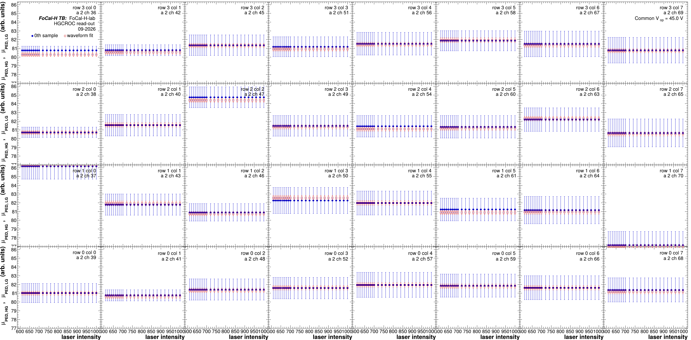<figcaption></figcaption></figure> <figure>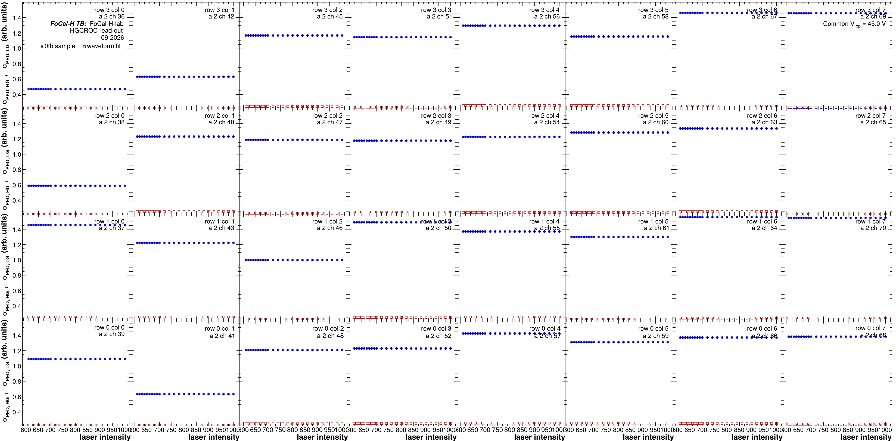<figcaption></figcaption></figure> <figure>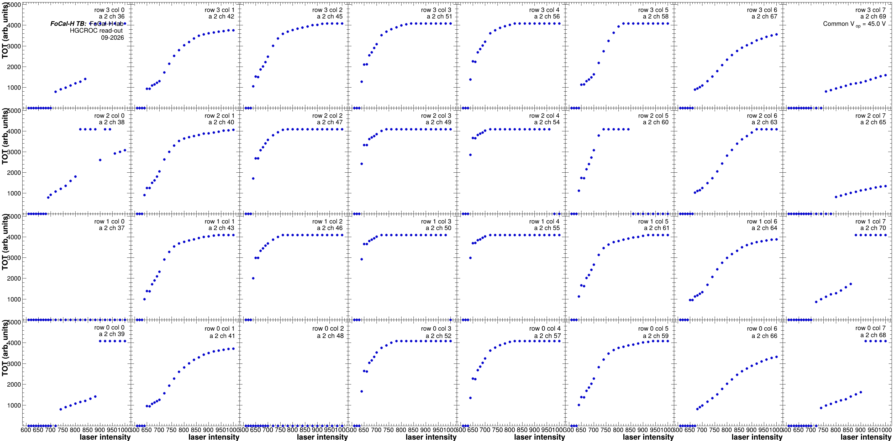<figcaption></figcaption></figure> <figure>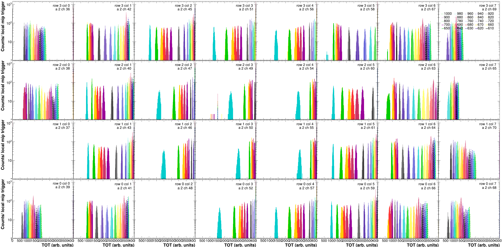<figcaption></figcaption></figure> <figure>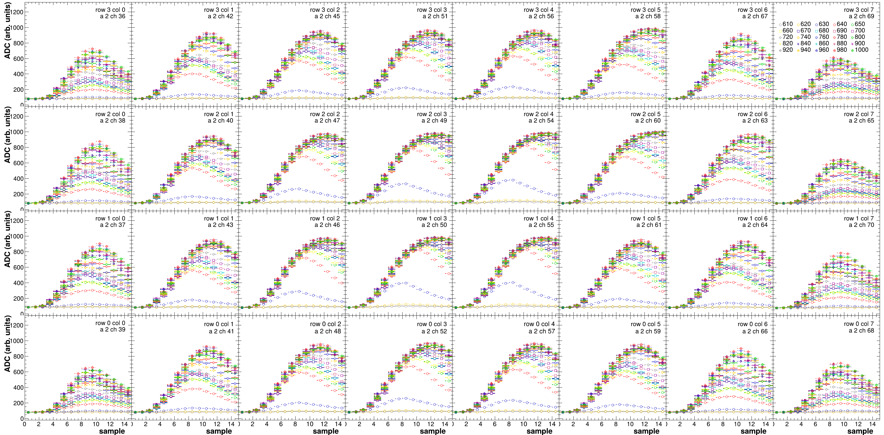<figcaption></figcaption></figure></div>

As well as single cell plots for the main quantities:&#x20;

<div><figure>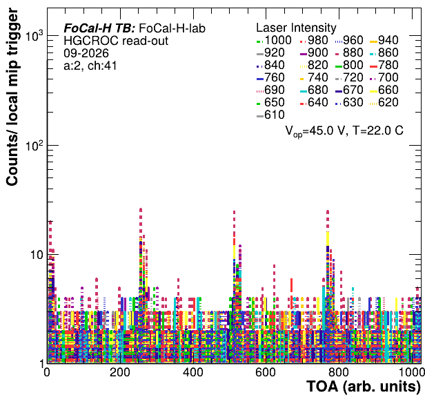<figcaption></figcaption></figure> <figure>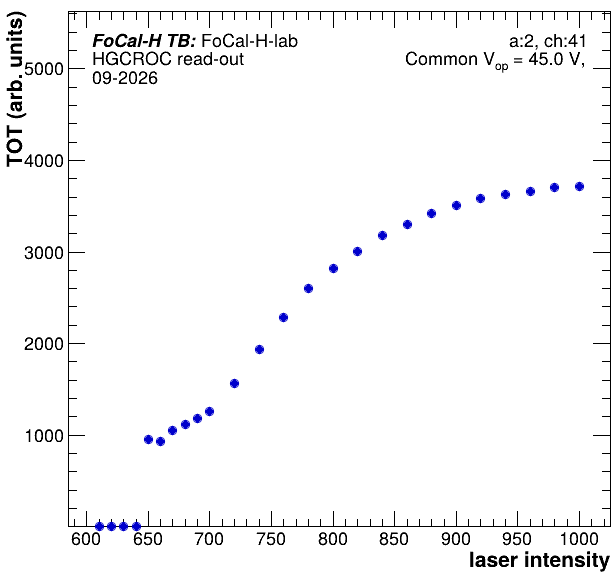<figcaption></figcaption></figure> <figure>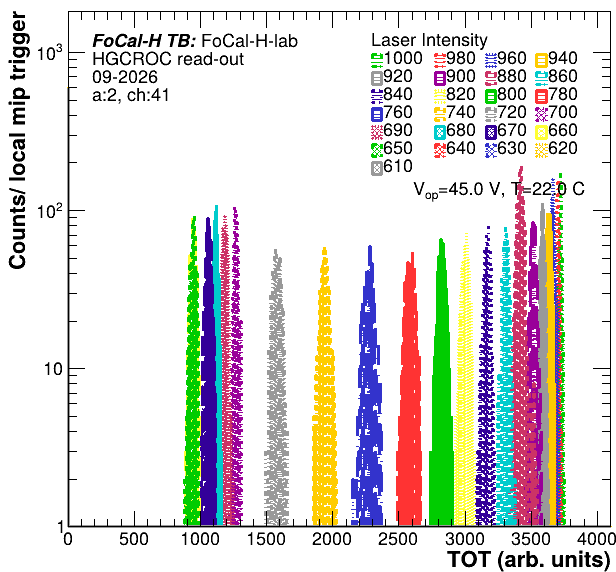<figcaption></figcaption></figure> <figure>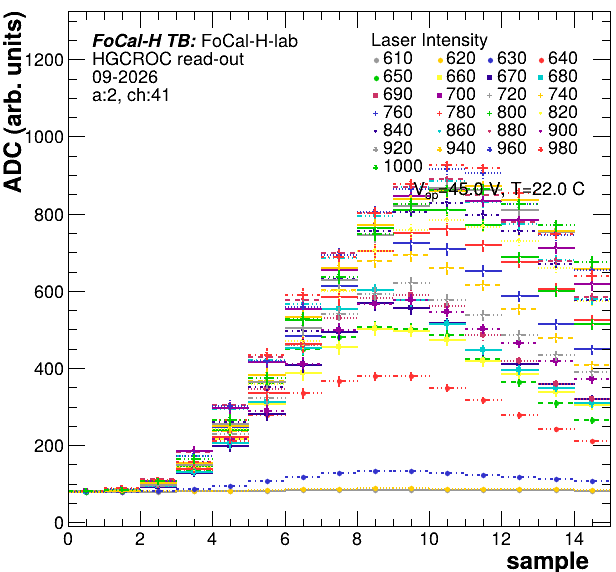<figcaption></figcaption></figure></div>

The distributions shown here are the raw distribution and the TOT as a function of laser intensity reflects the mean of the histogram (hence multiple peaks might be hidden). The waveform plots are plotted as TProfiles of the original waveforms taking in samples and thus uncorrected for the ToA offsets. Hence they should be taken with a grain of salt. For the best comparison of the waveforms and full evaluation of the TOT the output from the "wave"-step should be compared.&#x20;

The code behind these comparisons and and many other options can be found in the [ComparsionCalib.cc](https://github.com/eic/epic-lfhcal-tbana/blob/main/NewStructure/ComparisonCalib.cc) class and its header file.&#x20;

### Comparison of wave step

Similar to the previous comparison one program with several options steers the main comparison of the waveform step [CompareWaveform.cc](https://github.com/eic/epic-lfhcal-tbana/blob/main/NewStructure/CompareWaveform.cc) its underlying class can be found [here](https://github.com/eic/epic-lfhcal-tbana/blob/main/NewStructure/ComparisonWaveform.cc). As you can see the option set is rather similar and they also have similar meanings as described in the previous section.

```bash
./CompareWaveform -h
Usage:
./CompareWaveform [-option (arguments)]
Options:
-c ccc   list of cell to be plotted separately
-d [0-3] Debugging mode
-e [0-1] extended plotting
-E [1-X] histo reading options for expanded file list
-f       Force to write output if already exist
-F fff   set explicit plot extension explicitly, default is pdf 
-H       switch to HGCROC output
-i uuu   Input file list
-I uuu   expanded input file list
-L [1-63]restrict max layer plotting
-o vvv   Output file name (mandatory)
-O kkk   Output directory name for plots (mandatory)
-r rrr   Name of run list file  2024 PS TB [../configs/DataTakingDB_202409_CAEN.csv] 
-x XXXX  Give axis option with XXXX, defined: run, ite, integ, Vop, intensity
-h       this help

Examples:
./CompareWaveform (-f) -o TrendingOutput.root -i input_list.txt (-f to overwrite existing output)
./CompareWaveform (-f) -o TrendingOutput.root InputName*.root InputName2.root (-f to overwrite existing output)
```

An example running command can be found below

```bash
./CompareWaveform -d 1 -e 1 -E 1 -x laser -f -I listInputFiles.txt -o outputRootFile.root -O OutputFolder/ -r $runList  -c $cellList
```

It produces among others the following plots in the subfolder SingleLayers:

<div><figure>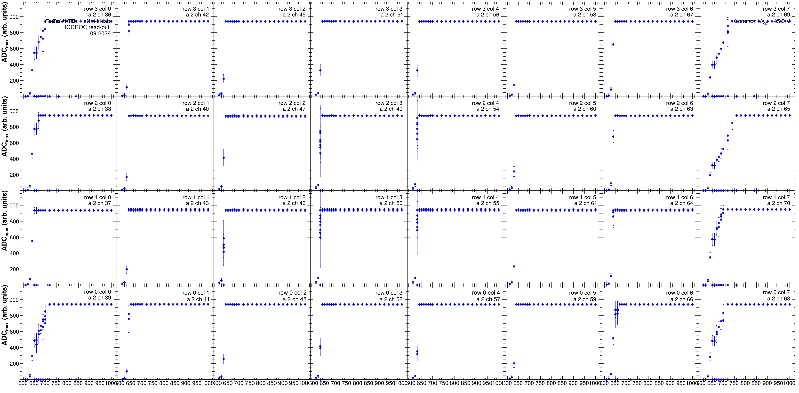<figcaption></figcaption></figure> <figure>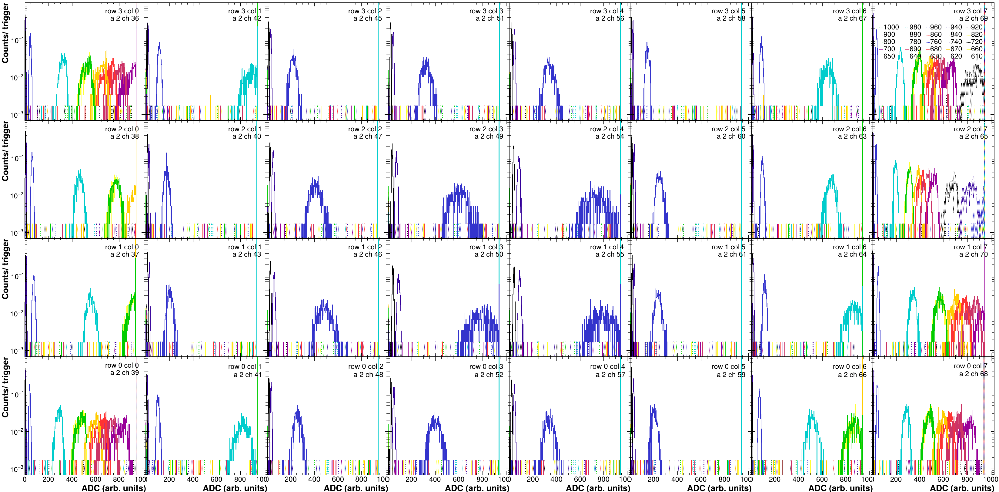<figcaption></figcaption></figure></div>

<div><figure><figcaption></figcaption></figure> <figure>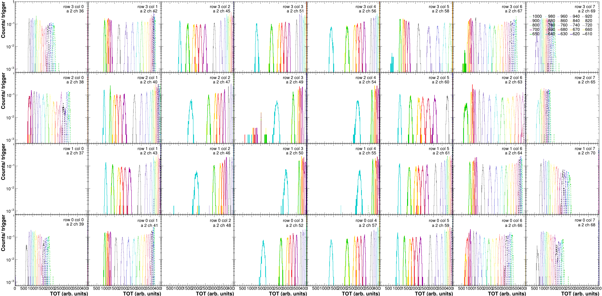<figcaption></figcaption></figure></div>

<div><figure>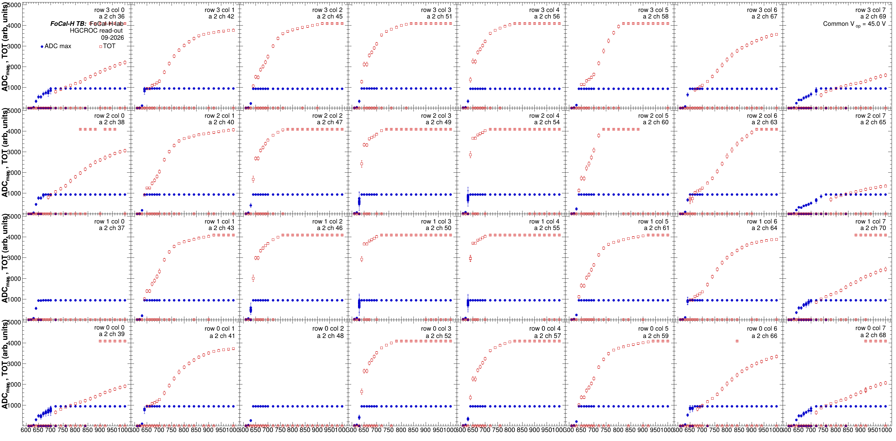<figcaption></figcaption></figure> <figure><figcaption></figcaption></figure></div>

<div><figure>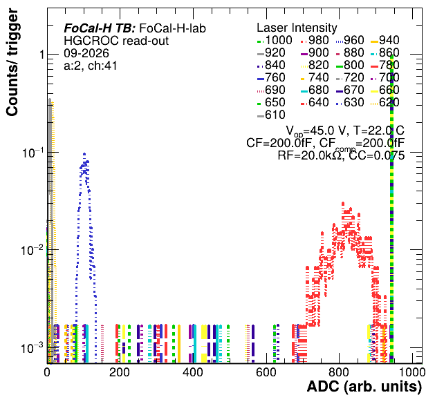<figcaption></figcaption></figure> <figure><figcaption></figcaption></figure> <figure>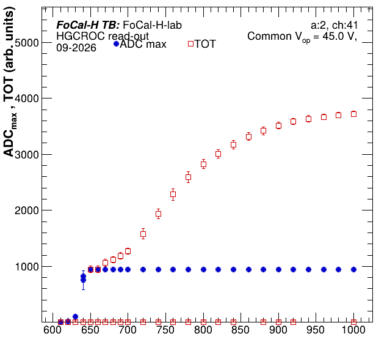<figcaption></figcaption></figure> <figure><figcaption></figcaption></figure></div>

